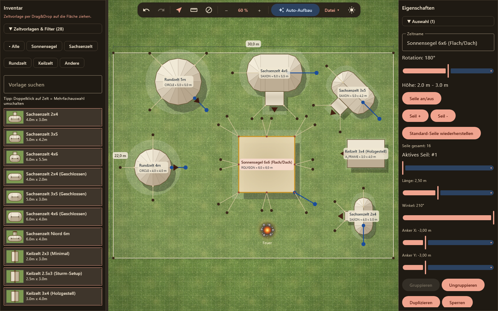
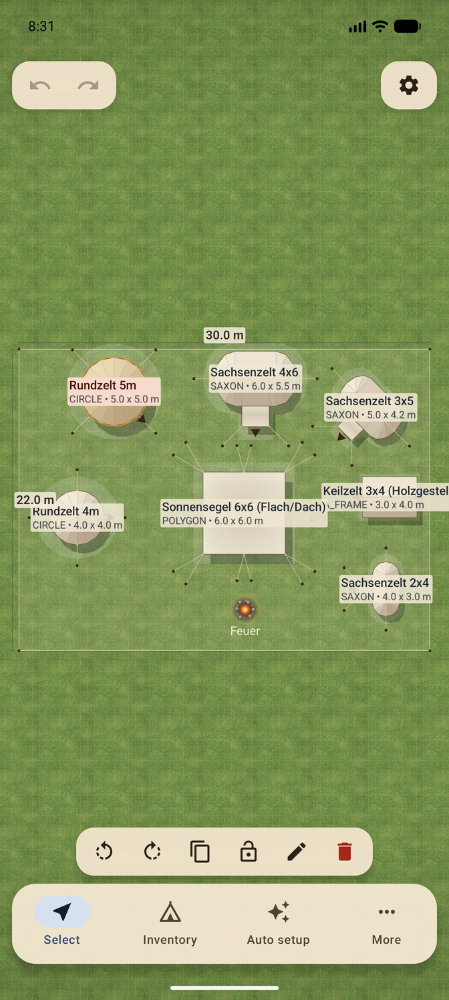
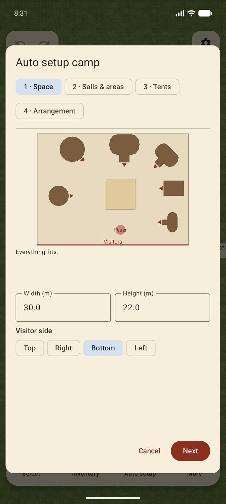
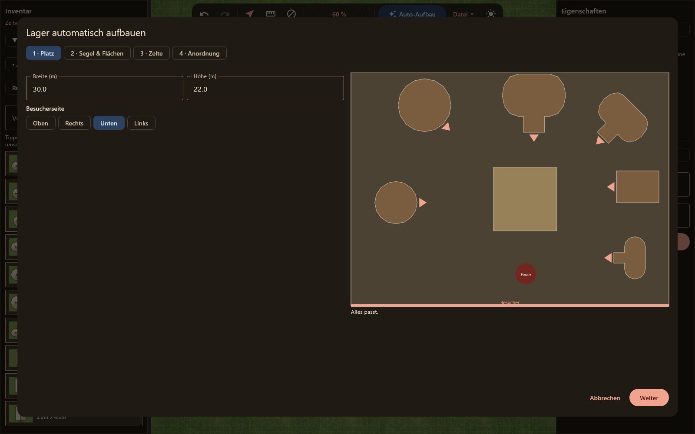

# Lagerplaner – Historical Camp Layout

Plan your reenactment or medieval market camp before you get there. Lay out Saxon tents, round tents,
wedge tents and sun sails on a to-scale plot, see right away where guy ropes cross or an entry is blocked,
or let the auto setup draft the whole camp for you. Runs on **Android** and **desktop** (Windows, macOS, Linux).



<p align="center">
  
  &nbsp;&nbsp;
  
</p>

## Features

**Plan to scale**
- Plot size in metres, with a measure tool to check distances.
- 28 tent and sun sail presets (Saxon, round, wedge, sun sails), searchable and filterable. Drag them onto the plot.
- Move, rotate, duplicate, group and lock tents. Undo and redo for every step.

**Real tents, real ropes**
- Every tent has guy ropes and a door. You can change their length, angle and anchor point, or add and remove ropes.
- Top-down art for tents, sun sails and fire pits, on a grass background.

**Checks while you plan**
- **Collisions:** tent bodies or ropes that run into other tents are marked red.
- **Warnings:** blocked entries, walkways narrower than your setting and tents on the auto setup's free areas are marked orange.
- Draw your own no-go zones, for example for trees, paths or a neighbour's space. Tents inside them are marked red.

**Auto setup**
- Give it the plot, visitor side, sun sails, fire pit or arena areas and your tents. It drafts a camp: a horseshoe,
  full or half circle around the sail, a U-shape, along the edges, or spread out.
- Preview updates live. If not everything fits, walkways shrink step by step and the lowest-priority tents
  are left out, and it tells you which ones.



**Share it**
- Export the layout as PNG, or as a project file to open on another device.
- English and German, light and dark theme, keyboard shortcuts on desktop.

## Run it

Desktop:

```shell
./gradlew :composeApp:run
```

Android (debug APK in `androidApp/build/outputs/apk/debug/`):

```shell
./gradlew :androidApp:assembleDebug
```

On Windows use `.\gradlew.bat` instead of `./gradlew`.

## Project structure

- [composeApp](./composeApp/src): the shared Compose Multiplatform app.
  - [commonMain](./composeApp/src/commonMain/kotlin): UI, geometry and collision engine, auto layout.
  - [androidMain](./composeApp/src/androidMain/kotlin) and [jvmMain](./composeApp/src/jvmMain/kotlin): storage, file export and other platform code.
- [androidApp](./androidApp/src/main): the thin Android shell (`MainActivity`, manifest, icons). AGP 9 no longer
  allows the Android application plugin in a Kotlin Multiplatform module, so `composeApp` is a library and
  `androidApp` packages it.

Tests: `./gradlew :composeApp:jvmTest`.

## Screenshots

The desktop screenshots are rendered by
[ReadmeScreenshots.kt](./composeApp/src/jvmTest/kotlin/de/voculupo/historicalcamplayout/ReadmeScreenshots.kt),
which also writes the sample camp to `docs/screenshots/sample-project.json`:

```shell
SCREENSHOT_DIR=docs/screenshots ./gradlew :composeApp:jvmTest --tests '*ReadmeScreenshots*'
```

The Android screenshots come from an emulator, with that sample camp copied into the app's
`files/historical_camp_project.json`.
